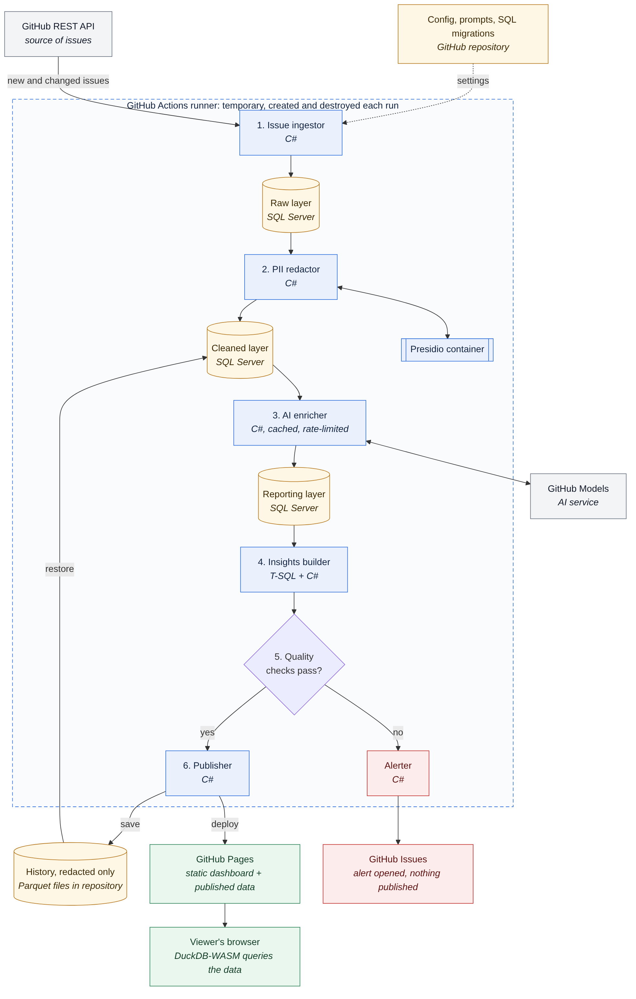

# Feedback Intelligence Platform

A system that reads public GitHub issues for popular open-source products every day, works out what users are struggling with, and publishes an always-current dashboard for product teams. It runs unattended, at no cost.

> **Status:** in development, milestone M1 (Foundation). The live dashboard will be linked here once the first end-to-end run is deployed (M2).

## What it does

Every day, the pipeline collects new and updated issues from tracked repositories (starting with [microsoft/winget-cli](https://github.com/microsoft/winget-cli)) and produces:

- **A category and severity** for each issue, with a one-line reason
- **Plain-English summaries** of long issues
- **Trends** in volume, category mix, and time to close
- **Emerging topics** that are growing quickly, and a **weekly digest**

Personal information such as emails, IP addresses, and access tokens is removed **before** any text is sent to AI or published.

## How it works



A scheduled GitHub Actions workflow runs a C# pipeline. Each run starts temporary SQL Server and Presidio containers, restores history, processes issues through raw, cleaned, and reporting layers, and publishes a static dashboard to GitHub Pages.

| Area | Technology |
|---|---|
| Pipeline | C# on .NET 10 |
| Data | SQL Server Express (T-SQL), Parquet |
| AI | GitHub Models |
| Privacy | Microsoft Presidio |
| Automation | GitHub Actions, GitHub Pages, GitHub Issues |
| Dashboard | HTML, JavaScript, DuckDB-WASM, Chart.js |

## Documentation

| Document | Markdown | PDF |
|---|---|---|
| Project plan | [project-plan.md](docs/project-plan.md) | [project-plan.pdf](docs/project-plan.pdf) |
| Requirements | [requirements.md](docs/requirements.md) | [requirements.pdf](docs/requirements.pdf) |
| Design | [design.md](docs/design.md) | [design.pdf](docs/design.pdf) |
| Data dictionary | [data-dictionary.md](docs/data-dictionary.md) | [data-dictionary.pdf](docs/data-dictionary.pdf) |
| Architecture decisions | [docs/adr](docs/adr/README.md) | |

The Markdown files are the official versions; the PDFs are readable copies.

## Running locally

## Running locally

Development uses Windows with WSL 2, Docker Desktop, the .NET 10 SDK, and VS Code ([ADR 0012](docs/adr/0012-wsl2-docker-development.md)).

1. Create your local settings file and set your own password:

```bash
   cp .env.example .env
```

2. Start SQL Server and Presidio:

```bash
   docker compose up -d
   docker compose ps   # wait until sqlserver shows (healthy)
```

3. Build and test:

```bash
   dotnet build
   dotnet test
```

| Service | Address |
|---|---|
| SQL Server (Developer edition) | `localhost,1433`, user `sa`, password from `.env` |
| Presidio analyzer | `http://localhost:5002` |
| Presidio anonymizer | `http://localhost:5001` |

Stop everything with `docker compose down`. Add `-v` to also delete the local database.
## Contributing

See [CONTRIBUTING.md](CONTRIBUTING.md) for the development workflow, standards, and AI-assisted development policy.
