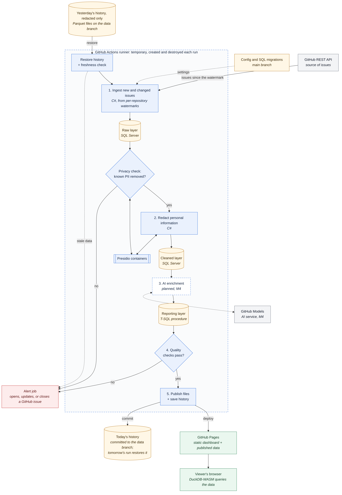

# Feedback Intelligence Platform

[](https://github.com/benjammin-dev/feedback-intelligence/actions/workflows/ci.yml)
[](https://github.com/benjammin-dev/feedback-intelligence/actions/workflows/pipeline.yml)

A system that reads public GitHub issues for popular open-source products every day, works out what users are struggling with, and publishes an always-current dashboard for product teams. It runs unattended, at no cost.

**Live dashboard:** [benjammin-dev.github.io/feedback-intelligence](https://benjammin-dev.github.io/feedback-intelligence/), updated daily.

> **Status:** in development. Milestone M2 (walking skeleton) is complete: the pipeline runs every day and publishes the weekly count of new winget-cli issues. Redaction, AI enrichment, and the full dashboard arrive in M3–M5.

## What it does

Every day, the pipeline collects new and updated issues from tracked repositories (starting with [microsoft/winget-cli](https://github.com/microsoft/winget-cli)) and produces:

- **A category and severity** for each issue, with a one-line reason
- **Plain-English summaries** of long issues
- **Trends** in volume, category mix, and time to close
- **Emerging topics** that are growing quickly, and a **weekly digest**

Personal information such as emails, IP addresses, and access tokens is removed **before** any text is sent to AI or published.

## How it works



A scheduled GitHub Actions workflow runs a C# pipeline. Each run starts temporary SQL Server and Presidio containers, restores history, processes issues through raw, cleaned, and reporting layers, and publishes a static dashboard to GitHub Pages. Quality checks must pass before anything is published, and any failure or stale data opens a `pipeline-alert` issue, which the next successful run closes.

| Area | Technology |
|---|---|
| Pipeline | C# on .NET 10 |
| Data | SQL Server Express (T-SQL), Parquet |
| AI | GitHub Models |
| Privacy | Microsoft Presidio |
| Automation | GitHub Actions, GitHub Pages, GitHub Issues |
| Dashboard | HTML, JavaScript, DuckDB-WASM, Chart.js |

## Documentation

| Document | Markdown | PDF |
|---|---|---|
| Project plan | [project-plan.md](docs/project-plan.md) | [project-plan.pdf](docs/project-plan.pdf) |
| Requirements | [requirements.md](docs/requirements.md) | [requirements.pdf](docs/requirements.pdf) |
| Design | [design.md](docs/design.md) | [design.pdf](docs/design.pdf) |
| Data dictionary | [data-dictionary.md](docs/data-dictionary.md) | [data-dictionary.pdf](docs/data-dictionary.pdf) |
| Architecture decisions | [docs/adr](docs/adr/README.md) | |

The Markdown files are the official versions; the PDFs are readable copies.

## Running locally

Development uses Windows with WSL 2, Docker Desktop, the .NET 10 SDK, Node.js 22 or later (for the dashboard), and VS Code ([ADR 0012](docs/adr/0012-wsl2-docker-development.md)). Commands run in the WSL terminal from the repository root.

**1. Start the local services** (SQL Server and Presidio):

```bash
cp .env.example .env    # first time only; then set your own password in .env
docker compose up -d
```

**2. Build and test:**

```bash
dotnet build
dotnet test             # integration tests start their own SQL Server through Testcontainers
```

**3. Run the pipeline:**

```bash
set -a; source .env; set +a
export ConnectionStrings__FeedbackIntel="Server=localhost,1433;Database=FeedbackIntel;User Id=sa;Password=$MSSQL_SA_PASSWORD;TrustServerCertificate=True"
export GITHUB_TOKEN=$(gh auth token)   # optional; without it GitHub allows 60 requests an hour
dotnet run --project src/FeedbackIntel.Pipeline
```

To backfill, set a creation-date range for one run, for example `export Backfill__From=2026-08-01 Backfill__To=2026-08-31` (on GitHub, use the *Run workflow* inputs instead). Unset both afterwards.

The very first run on an empty local database has no history to restore, so start it with `export Operations__Bootstrap=true`. After that, the local database keeps its data and the variable isn't needed. Each run also writes history files to `out/history`.

Settings live in [`config/pipeline.json`](config/pipeline.json). Any value can be overridden with an environment variable, such as `Publishing__OutputDirectory`. Secrets only ever come from environment variables.

**4. View the dashboard:**

```bash
(cd dashboard && npm ci && npm run build)   # adds the pages and pinned libraries to out/site
python3 -m http.server 8080 --directory out/site
```

Then open http://localhost:8080.

## Data use

The pipeline reads public issues through GitHub's API, within its rate limits. It never stores usernames, removes personal information such as emails, IP addresses, and access tokens before anything is saved or published, and publishes only redacted titles and AI summaries, each linking back to the original issue. If you'd like an issue removed from the dashboard, [open an issue](https://github.com/benjammin-dev/feedback-intelligence/issues) with its link.

## Contributing

See [CONTRIBUTING.md](CONTRIBUTING.md) for the development workflow, standards, and AI-assisted development policy.
