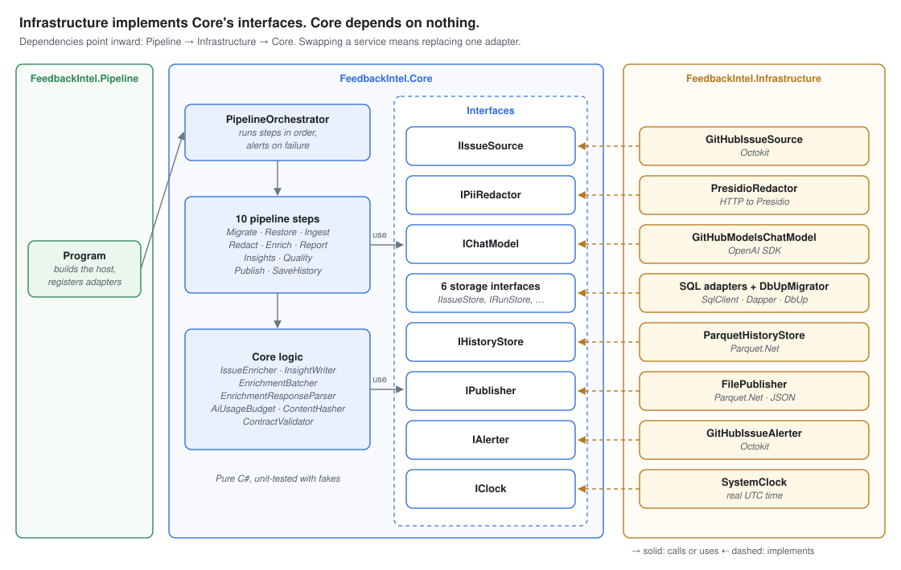

# Design: Feedback Intelligence Platform

| | |
|---|---|
| **Status** | Approved |
| **Version** | 1.0 |
| **Date** | 2026-10-18 |
| **Owner** | Benjamin Rose |
| **Related** | [Project plan](project-plan.md), [Requirements](requirements.md), [Data dictionary](data-dictionary.md), [Decision records](adr/README.md) |

This document describes how the Feedback Intelligence Platform is built: its architecture, components, failure handling, configuration, dashboard, security, and repository layout. Detailed table definitions are in the [data dictionary](data-dictionary.md), and the reasoning behind each major choice is in the [decision records](adr/README.md).

---

## 1. Architecture

A scheduled GitHub Actions workflow runs a C# pipeline once a day. Each run starts temporary SQL Server and Presidio containers, restores history, processes new and changed issues through raw, cleaned, and reporting layers, and publishes a static dashboard to GitHub Pages. The runner is destroyed afterward, so nothing survives except what is deliberately saved.


*Source: [`diagrams/architecture.mmd`](diagrams/architecture.mmd) (Mermaid).*

| Environment | What runs there |
|---|---|
| GitHub Actions runner (temporary) | The C# pipeline, SQL Server Express, and Presidio containers |
| GitHub repository | Code, config, prompts, migrations, docs; history on the `data` branch |
| GitHub Pages | The static dashboard and its published data files |
| Viewer's browser | Dashboard code and DuckDB-WASM |
| External services | GitHub REST API (issues) and GitHub Models (AI) |

**Key decisions:** [ADR 0002](adr/0002-run-on-github.md) (GitHub as platform), [0004](adr/0004-sql-server-express-container.md) (temporary SQL Server), [0005](adr/0005-history-parquet-data-branch.md) and [0013](adr/0013-exclude-bodies-from-history.md) (history), [0009](adr/0009-raw-cleaned-reporting-layers.md) (data layers).

---

## 2. Data design

Data moves through four SQL Server schemas:

| Schema | Holds | Saved as history | Published |
|---|---|---|---|
| `raw` | Issues as fetched, unredacted | Never | Never |
| `cleaned` | Redacted issues, AI results, digests | Yes (without issue bodies) | No |
| `reporting` | Aggregates and dashboard tables, rebuilt each run | No | Yes |
| `ops` | Run records and watermarks | Yes | Run health only |

The **data contract** lists every field allowed in published and history files; an automated test enforces it. Full definitions: [data dictionary](data-dictionary.md).

---

## 3. Components



| Project | Responsibility |
|---|---|
| `FeedbackIntel.Core` | Data models, interfaces, pipeline steps, and pure logic (batching, validation, hashing, data contract). No external dependencies, so it is fully unit-testable with fakes. |
| `FeedbackIntel.Infrastructure` | Adapters that implement Core's interfaces using real services: Octokit, Presidio over HTTP, the OpenAI SDK for GitHub Models, SqlClient with Dapper and DbUp, and Parquet.Net. |
| `FeedbackIntel.Pipeline` | Console entry point. Loads configuration, registers adapters through dependency injection, and starts the orchestrator. |
| `FeedbackIntel.Core.Tests` | Fast unit tests using fakes. |
| `FeedbackIntel.Integration.Tests` | Tests against real SQL Server and Presidio containers via Testcontainers. |
| `FeedbackIntel.Evaluation` | Scores prompts against the labeled evaluation set (FR-DEV-02). |

**Dependency rule:** Infrastructure depends on Core; Core depends on nothing. Every external service sits behind an interface, so it can be faked in tests or replaced by another provider (NFR-MNT-03). Class-level documentation lives in the code as XML doc comments.

**Interfaces:** `IPipelineStep`, `IIssueSource`, `IPiiRedactor`, `IChatModel`, `IIssueEnricher`, `IInsightWriter`, `IDatabaseMigrator`, `IIssueStore`, `IEnrichmentStore`, `IRunStore`, `IReportingBuilder`, `IQualityChecker`, `IHistoryStore`, `IPublisher`, `IAlerter`, `IClock`.

---

## 4. Pipeline flow and error handling

### Rules

1. **Temporary errors are retried; permanent errors are not.** Network errors, timeouts, and rate-limit responses are retried up to 3 times with increasing waits (2, 4, 8 seconds). Bad data, bad configuration, and code errors fail immediately.
2. **Any failure stops the run.** The orchestrator records the failed step, saves the run record, raises an alert, and exits with a failure code. Nothing later runs, so nothing half-finished is published.
3. **A failed run is never harmful.** The dashboard keeps the last good data, and the watermark doesn't move, so the next run picks up everything missed.
4. **Timeouts:** the pipeline step has a 40-minute limit inside a 50-minute job, leaving time for the failure-alert step. The normal run target is 30 minutes (NFR-PERF-03).
5. **Logging:** every log entry carries the run ID and step name automatically (NFR-OBS-01). Logs never include issue text, because run logs of a public repository are public.

### Steps

| # | Step | On failure | Retried? |
|---|---|---|---|
| — | Freshness check (after restore) | Stale-data alert if data is older than 48 hours; the run continues | — |
| 1 | Migrate database | Alert | Waits up to 2 minutes for SQL Server; script errors not retried |
| 2 | Restore history | Alert, unless it is a manual **bootstrap** run | No |
| 3 | Ingest issues | Alert; also fails if more than 10% of records are rejected | Yes; waits for a rate-limit reset only if under 15 minutes |
| 4 | Redact | Alert; **never continues without redaction** | Yes |
| 5 | Enrich | Not a run failure: invalid answers become `unclassified`; unprocessed issues stay `pending` | Yes; requests spaced about 4 seconds apart; every attempt counts against the daily budget |
| 6 | Rebuild reporting | Alert | No |
| 7 | Build insights | Not a run failure: topics show "unavailable today"; a missing digest is generated on the next run | Yes |
| 8 | Quality checks | Alert listing every failed check; nothing published | No |
| 9 | Publish (write files) | Alert; contract violations are treated as possible privacy issues | Write errors yes; violations no |
| 10 | Save history (write files) | Alert | Yes |
| — | Workflow: deploy Pages, push history | Workflow-level alert, if the pipeline hasn't already raised one | Yes |

**Two deliberate exceptions:** AI problems never fail the run, because the AI is an enhancement and the dashboard should still update. Redaction problems always fail it, because privacy is never traded for availability.

---

## 5. Configuration

All tunable behavior lives in `config/pipeline.json`, validated against `config/pipeline.schema.json` in CI and at startup (FR-CFG-01, FR-CFG-02). Any value can be overridden by an environment variable, which is how local runs redirect output away from the live site.

```jsonc
{
  "Repositories": [
    { "Owner": "microsoft", "Name": "winget-cli", "Enabled": true },
    { "Owner": "microsoft", "Name": "PowerToys",  "Enabled": false },
    { "Owner": "microsoft", "Name": "vscode",     "Enabled": false }
  ],
  "Ingestion":      { "InitialHistoryDays": 90, "MaxRejectedPercent": 10, "RateLimitMaxWaitMinutes": 15 },
  "Classification": { "Categories": [ "bug", "feature_request", "question", "docs", "performance" ],
                      "Severities": [ "low", "medium", "high", "critical" ] },
  "Ai":             { "Endpoint": "https://models.github.ai/inference", "Model": "openai/gpt-4.1-mini",
                      "PromptDirectory": "prompts/v1", "DailyRequestLimit": 140,
                      "MinSecondsBetweenRequests": 4, "MaxIssuesPerRequest": 10,
                      "MaxCharactersPerRequest": 24000, "MaxRetries": 3 },
  "Text":           { "BodyMaxCharacters": 4000, "SummaryMinBodyCharacters": 500 },
  "Insights":       { "TopicMinIssues": 3, "TopicWindowDays": 7, "DigestMaxWords": 300 },
  "Operations":     { "StaleDataAlertHours": 48, "SqlStartupWaitSeconds": 120 },
  "Publishing":     { "OutputDirectory": "out/site", "HistoryDirectory": "out/history" }
}
```

| Not in this file | Where it lives | Why |
|---|---|---|
| Schedule and timeouts | Workflow file | GitHub reads these only from workflow files |
| Tokens and passwords | Environment variables | Secrets never enter the repository (NFR-SEC-01) |
| Database connection string | Environment variable | Differs between local, CI, and production |

**Notes:**

- **Categories and severities come from config, not code enums,** so they can change through a pull request (US-12). Because changing them also affects the prompts and evaluation labels, CI checks that all three agree.
- **The model name is an example,** to be confirmed in M4 against the evaluation set.
- **The daily AI limit is 140,** deliberately below GitHub's limit of about 150 to leave a safety margin.

---

## 6. Dashboard

A static site of plain HTML and JavaScript, with charts drawn by Chart.js and queries run in the browser by DuckDB-WASM ([ADR 0008](adr/0008-static-dashboard-duckdb-wasm.md)).

| Page | Shows | Reads | Milestone |
|---|---|---|---|
| Overview | Last 7 days vs. previous 7: new, closed, % bugs, critical, median days to close | `site_info.json`, `overview.json` | M3 |
| Trends | Weekly volume, closures, and category mix; repository and date filters | `weekly_metrics.parquet`, `weekly_category.parquet` | M3 |
| Issue explorer | Searchable, filterable issue table with links to GitHub; CSV export (M8) | `issues.parquet` | M3 |
| Emerging topics | Ranked fast-growing topics; select one to list its issues | `topics.parquet`, `topic_issues.parquet`, `issues.parquet` | M5 |
| Weekly digest | Latest digest and archive | `digests.parquet` | M5 |
| Pipeline health | Last 30 runs, data freshness, AI usage vs. limit | `run_health.parquet`, `site_info.json` | M5 |

**Loading:** the Overview page renders immediately from two small JSON files; DuckDB-WASM loads in the background and is needed only for the other pages. This addresses the 3-second load target (NFR-PERF-02).

**Every page shows:** a repository selector, the time the data was last updated (FR-DSH-05), and an "AI-generated" marker next to AI categories, severities, summaries, topics, and digests (FR-DSH-06).

**Accessibility:** responsive layout for desktop and mobile (NFR-USE-01); WCAG AA contrast, and charts that never rely on color alone (NFR-USE-02).

---

## 7. Security and privacy

| Threat | Mitigation |
|---|---|
| Personal information in issue text reaches the AI, history, or dashboard | Presidio redaction before anything leaves the raw layer; usernames never collected; bodies never saved or published; data contract test; PII test set in CI (FR-PRV-01 to 04, ADR 0013) |
| **Issue text printed in public run logs** | Logs record counts, IDs, and step names only, never issue text. Run logs of a public repository are visible to anyone. |
| **Malicious HTML or script in issue titles or AI output** (cross-site scripting) | The dashboard inserts all data as plain text, never as HTML, and the site sets a Content Security Policy that blocks inline scripts. |
| Prompt injection through issue text | Issue text is clearly marked as data in prompts; AI output is parsed as JSON and validated against configured values; the AI has no ability to act (NFR-SEC-03, risk R4) |
| Leaked credentials | Only the built-in, short-lived `GITHUB_TOKEN` is used; secret scanning in CI (NFR-SEC-01) |
| Over-privileged workflow | Each job declares minimum permissions; only the alert step can write issues, and only the deploy step can write Pages (NFR-SEC-02) |
| Compromised dependency or third-party action | Dependency vulnerability scanning in CI; third-party GitHub Actions pinned to exact commit versions (NFR-SEC-04) |
| Incorrect or harmful data published | Quality checks gate publishing; the contract validator blocks unexpected fields; failures publish nothing |

---

## 8. Repository structure

```
feedback-intelligence/
├── README.md                    ← front door: what it is, live link, how to run
├── CONTRIBUTING.md              ← workflow, standards, AI-assisted development guide
├── .gitattributes               ← consistent line endings (ADR 0012)
├── .github/
│   ├── workflows/               ← ci.yml, pipeline.yml, evaluate.yml
│   └── pull_request_template.md ← self-review checklist and AI disclosure
├── config/                      ← pipeline.json and its schema
├── prompts/v1/                  ← versioned AI prompts
├── database/migrations/         ← numbered .sql scripts (DbUp)
├── src/
│   ├── FeedbackIntel.Core/
│   ├── FeedbackIntel.Infrastructure/
│   └── FeedbackIntel.Pipeline/
├── tests/
│   ├── FeedbackIntel.Core.Tests/
│   ├── FeedbackIntel.Integration.Tests/
│   └── FeedbackIntel.Evaluation/   ← includes the labeled evaluation set
├── dashboard/                   ← static site source
├── deploy/                      ← Bicep templates, validated in CI only (M7)
├── docker-compose.yml           ← local SQL Server and Presidio
└── docs/                        ← plan, requirements, design, data dictionary, ADRs, diagrams
```

The `data` branch holds only history files and is written only by the pipeline workflow.

---

## 9. Open items to verify during the build

| Item | When |
|---|---|
| Whether daily commits to the `data` branch keep scheduled workflows active (ADR 0005, risk R6) | M2 |
| SQL Server container startup time on GitHub runners (assumption A4) | M2 |
| Presidio accuracy on real issues, including custom recognizers (assumption A5) | M3 |
| Dashboard load time with DuckDB-WASM (NFR-PERF-02) | M3 |
| Model choice and prompt accuracy against the evaluation set (assumption A6) | M4 |

---

## Revision history

| Version | Date | Change |
|---|---|---|
| 1.0 | 2026-10-18 | Initial design approved |
